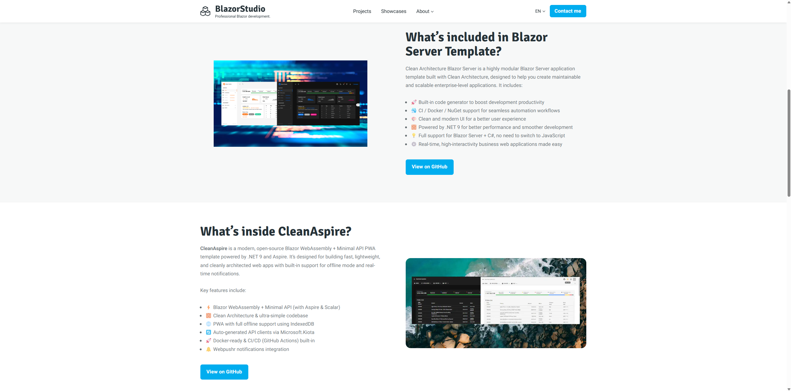

# My Personal Website


> 🌟 This website is based on the beautiful [Hugobricks](https://github.com/jhvanderschee/hugobricks) theme by [jhvanderschee](https://github.com/jhvanderschee). Many thanks for sharing such a great template under the MIT License!

Welcome to my personal website!  
This site serves as a hub to showcase my open-source projects, real-world enterprise business applications, and personal technical journey.



## 🌐 About the Website

This website is built using [Hugo](https://gohugo.io/), a fast and modern static site generator. It supports both English and Chinese content, making it easy for a global audience to explore my work.

## 📂 What You’ll Find Here

- **🚀 Open Source Projects**  
  Explore the source code and documentation for the tools, frameworks, and templates I’ve developed or contributed to.

- **🏢 Real-World Enterprise Applications**  
  Discover practical examples of enterprise systems I’ve built, including architecture design, implementation details, and solutions tailored for industries such as manufacturing, sales, and operations.

- **📝 Technical Articles**  
  Read posts about software engineering practices, architecture patterns, and hands-on development tips from my professional experience.

## 📎 Repository Contents

- `content/` – Website content including blog posts and project pages  
- `layouts/` – Custom layouts and theme adjustments  
- `static/` – Static assets like images and downloads  
- `config.toml` – Hugo site configuration  

## 🚀 Publish Commands

Requires Hugo **v0.141.0 or newer** for locally generated WeChat sharing QR codes ([`images.QR`](https://gohugo.io/functions/images/qr/)). Article, project, and showcase pages include X, Facebook, WeChat, and Reddit sharing buttons with English and Chinese labels. WeChat opens a native browser popover with the article QR code and a selectable link; no API keys or third-party sharing scripts are required.

Share text uses the article's authored `summary`, falling back to `description`, `seo.description`, or introductory body text. Preview cards use `seo.description` or `description`. X adds up to three hashtags from the article's `tags`, removing spaces and punctuation, and shortens the text to leave room for the hashtags and article link. Reddit includes the summary in the post body.

Facebook reads the preview summary from `og:description`; it cannot prefill the post body with that summary. Its share link includes the first valid article hashtag, while all article `tags` are included as Open Graph `article:tag` metadata. Facebook supports a single prefilled hashtag and has deprecated the `quote` parameter.

```bash
hugo --cleanDestinationDir --minify --baseURL https://blazorserver.com/
docker build . -t blazorstudiodev:v15
```

## 📄 License

This project is licensed under the [MIT License](LICENSE).
